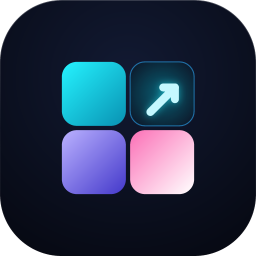

  

  # PluginPilot

  **The Smart Desktop Manager for Adobe Creative Cloud Plugins & Assets**

  
  [-0078D6?logo=windows)](https://github.com/rakibpixel/PluginPilot/releases)
  
  

  

    <b>Fast, lightweight, zero-configuration drag-and-drop installer for plugins, scripts, presets, LUTs, and CEP extensions.</b>
  

  [Download Latest Release](https://github.com/rakibpixel/PluginPilot/releases/latest) • [Key Features](#features) • [Supported Hosts](#supported-adobe-applications) • [File Formats](#supported-formats) • [Security](#security--privacy)

---

## 🚀 Overview

Installing Adobe plugins, scripts, and extensions manually often requires digging through complex, hidden directories—such as `%APPDATA%`, `Common Files\MediaCore`, `Presets\Scripts`, and `CEP\extensions`. 

**PluginPilot** eliminates this hassle completely. Simply drop your files or archives into PluginPilot, and the app automatically identifies your installed Adobe applications, classifies the asset type, and routes it to the exact correct directory with zero guesswork.

---

## 📥 Download & Install

You can download the latest official release directly from our [Releases Page](https://github.com/rakibpixel/PluginPilot/releases/latest):

| Package Type | Description | Link |
| :--- | :--- | :--- |
| **MSIX Package (Recommended)** | Sandboxed Windows package with auto-updates and clean uninstall | [Download .msix](https://github.com/rakibpixel/PluginPilot/releases/latest) |
| **MSIX Bundle** | Multi-architecture Windows Store package | [Download .msixbundle](https://github.com/rakibpixel/PluginPilot/releases/latest) |
| **Standalone Setup** | Standard Windows installer (.exe) | [Download .exe](https://github.com/rakibpixel/PluginPilot/releases/latest) |

---

## ✨ Features

- **Intuitive Drag-and-Drop:** Drop single files, folders, or entire `.zip` / `.rar` archives directly into the app for instant analysis and installation.
- **Multi-Host Discovery:** Automatically scans and detects installed versions of Adobe Photoshop, Premiere Pro, After Effects, and Illustrator (2020 through 2026+).
- **Archive Extraction & Deep Scan:** Automatically unpacks and extracts nested `.zip` and `.rar` packages, filtering safe contents and skipping manual unzipping.
- **Asset Library & Rollback:** View an inventory of all installed add-ons with toggle enable/disable controls, safe uninstall, and automatic timestamped backups for one-click rollback.
- **User Consent for CEP Panels:** Configures Adobe CSXS PlayerDebugMode for unsigned developer panels only after an explicit confirmation dialog.
- **Ultra-Lightweight & Fast:** Built natively with Rust and Tauri v2 for near-instant launch times and minimal resource usage.

---

## 🎯 Supported Adobe Applications

PluginPilot automatically detects versions **2020, 2021, 2022, 2023, 2024, 2025, and 2026+** for:

| Adobe Host | Supported Extensions & Formats |
| :--- | :--- |
| **Adobe Photoshop** | `.8bi` plugins, `.jsx` / `.jsxbin` scripts, `.atn` actions, `.abr` brushes, CEP panels |
| **Adobe Premiere Pro** | `.aex` MediaCore plugins, `.prfpset` presets, `.cube` LUTs, `.mogrt` graphics, CEP panels |
| **Adobe After Effects** | `.aex` plugins, `.ffx` presets, ScriptUI Panels (`.jsx` / `.jsxbin`), CEP panels |
| **Adobe Illustrator** | `.aip` plugins, `.jsx` scripts, CEP panels |

---

## 📦 Supported Formats

- **Scripts:** `.jsx`, `.jsxbin`, `.js` (Photoshop/Illustrator scripts, After Effects ScriptUI Panels)
- **Color LUTs:** `.cube`, `.3dl`, `.look` (Common 3D Creative and Technical LUTs)
- **Presets:** `.ffx` (After Effects animation presets), `.prfpset` (Premiere Pro presets)
- **Motion Graphics:** `.mogrt` (Essential Graphics templates)
- **Native Plugins:** `.8bi` (Photoshop filters), `.aex` (After Effects & shared MediaCore effects)
- **Extensions:** CEP panels (`manifest.xml`), `.zxp` extension packages
- **Archives:** `.zip`, `.rar` (Deep scanning for embedded add-on payloads)

---

## 🔒 Security & Privacy

PluginPilot operates **100% locally and offline**:
- **Strict Path Whitelisting:** File operations are strictly restricted to verified Adobe folders and the app's own directory (`is_allowed_destination`).
- **Archive Safety:** Implements Zip-Slip directory traversal protection and fail-closed archive verification.
- **Elevated Execution Integrity:** Elevated batch scripts are verified with SHA-256 and executed in memory.
- **Zero Telemetry:** No user analytics, no background tracking, no remote data collection.

---

## ⚖️ Trademark Disclaimer

*Adobe, Photoshop, Illustrator, Premiere Pro, After Effects, and Creative Cloud are registered trademarks of Adobe Inc. PluginPilot is an independent third-party desktop utility and is not affiliated with, endorsed by, or sponsored by Adobe Inc.*

---

## 📬 Support & Contact

If you have questions, feedback, or need assistance:
- **Email:** rakibpixel.chat@gmail.com
- **Publisher:** ToolsBrick
